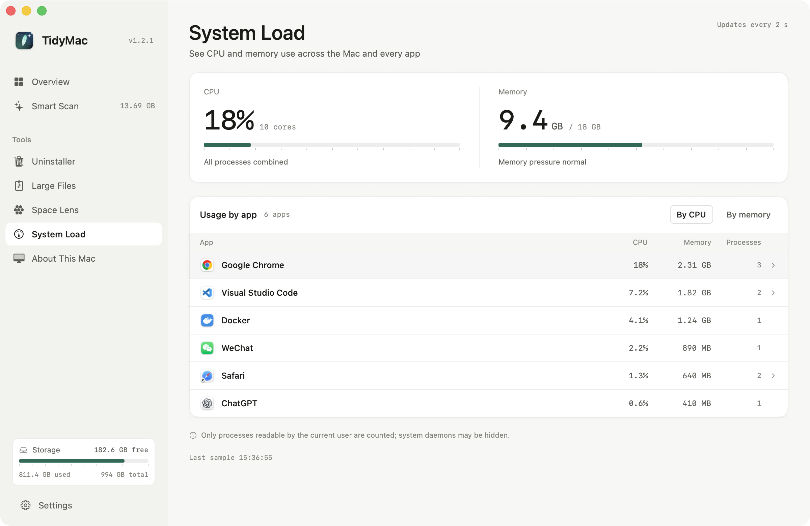
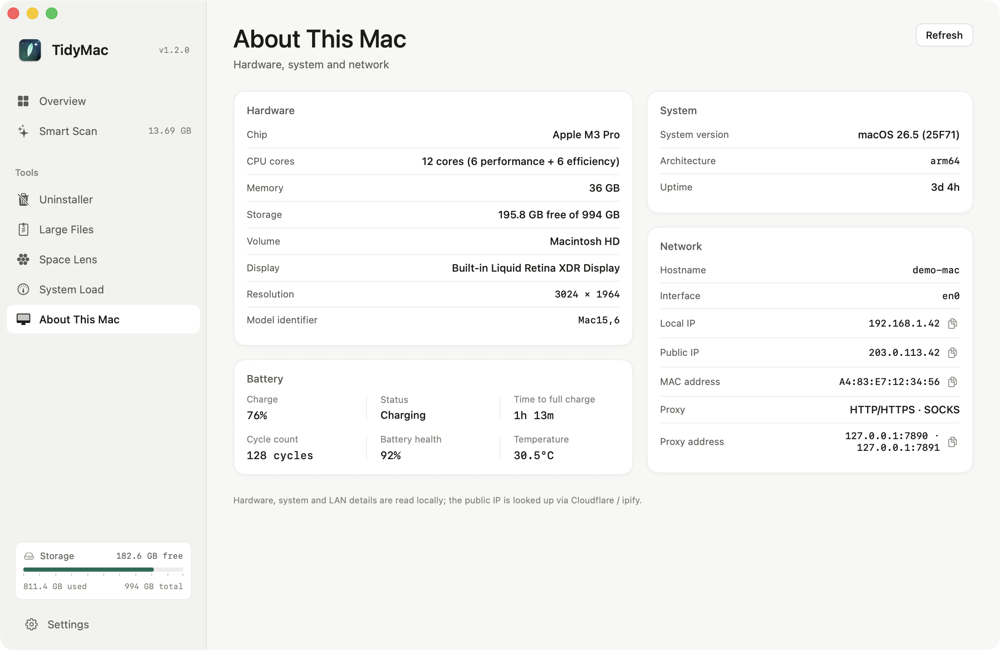
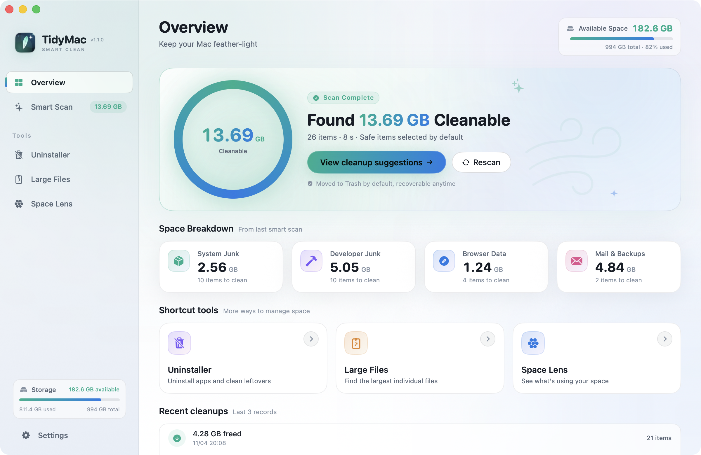
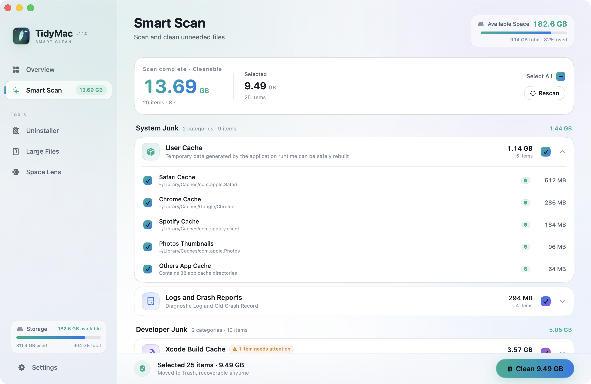
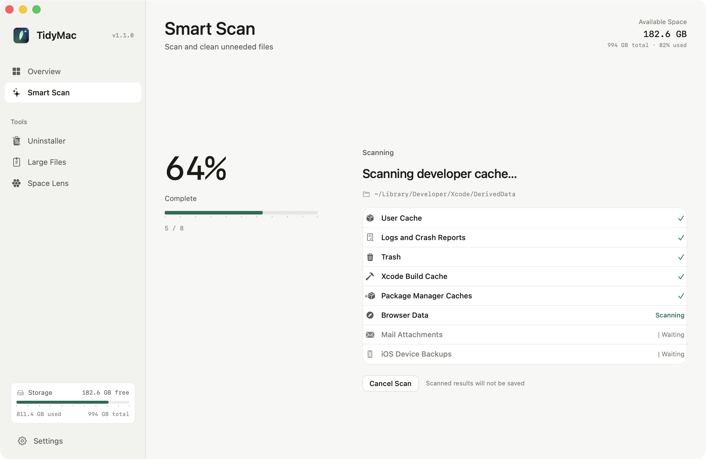
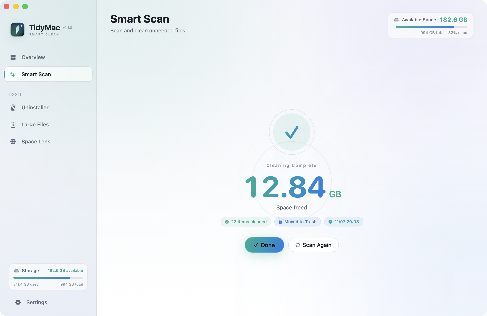
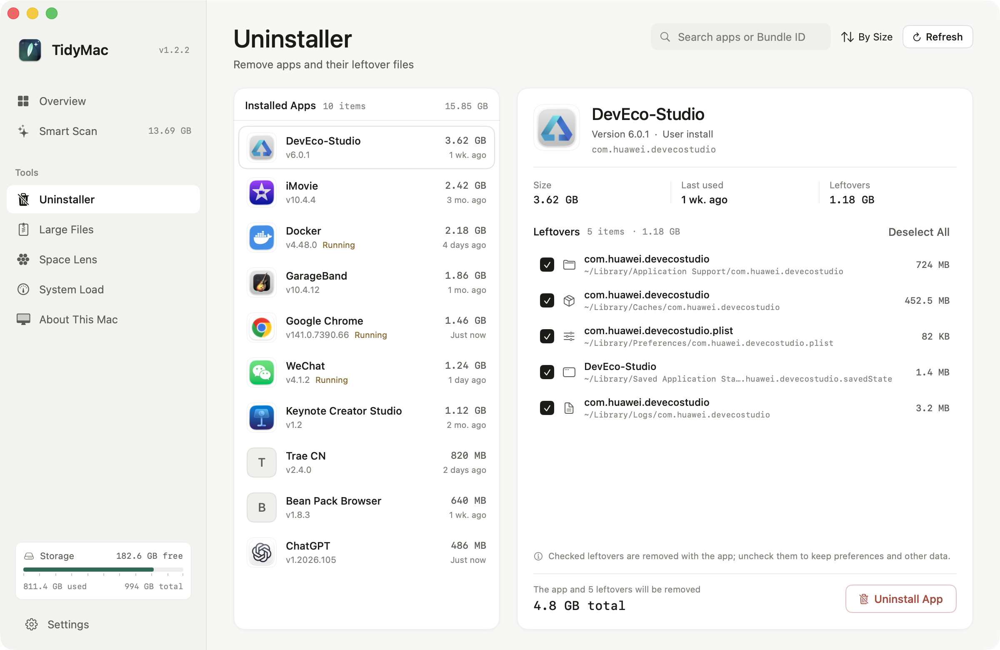
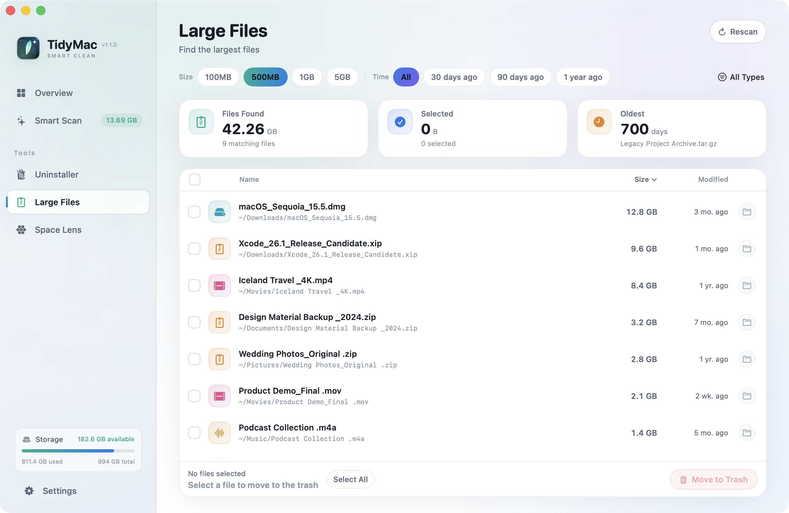
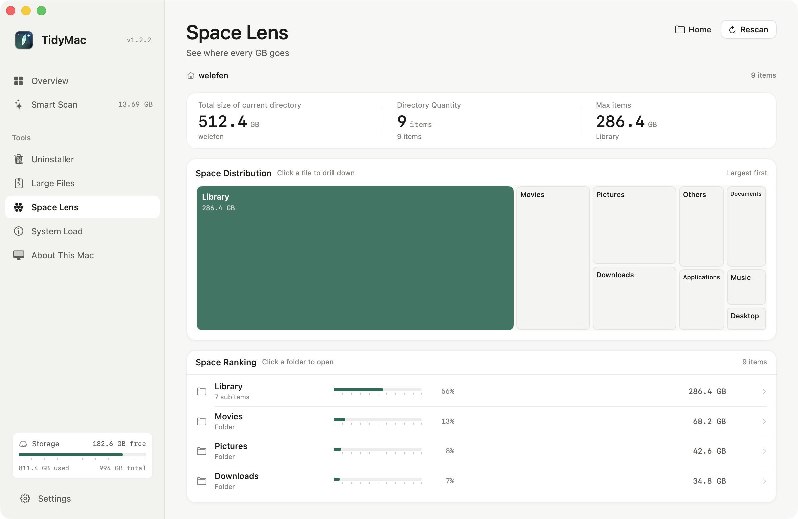
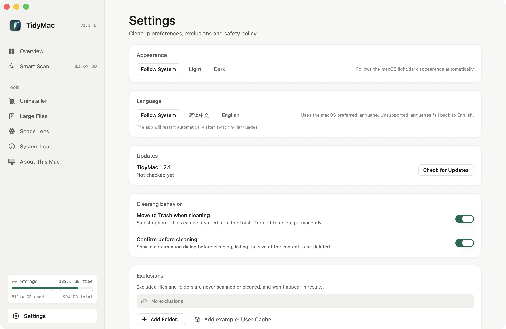

# TidyMac

[简体中文](README.zh-CN.md) | [English](README.md)

> Feather-light, fresh and clean. A smart cleaner and disk space manager for macOS.


TidyMac is a native SwiftUI macOS app: it scans system caches and developer junk, uninstalls apps together with leftovers, finds large files, shows where your disk space went with Space Lens, and monitors CPU and memory use by app. It supports light/dark appearance and follows the system by default. All file analysis happens locally; the only network telemetry is anonymous usage events (see [Anonymous Analytics](#anonymous-analytics)). Cleaned items are **moved to the Trash by default**, and sensitive locations such as system folders, Keychains, and the Photos library are hard-protected.

[](https://github.com/welefen/TidyMac/raw/main/updates/TidyMac-1.2.0.zip)

Also available as a [DMG disk image](https://github.com/welefen/TidyMac/raw/main/updates/TidyMac-1.2.0.dmg).

## Features

### Smart Scan
- User caches, logs and crash reports, Trash
- Xcode DerivedData / DeviceSupport / simulator caches
- npm, pnpm, Homebrew, pip, CocoaPods, SwiftPM, Gradle, Go and Cargo caches
- Safari / Chrome / Firefox / Edge web caches
- Mail attachments and iOS device backups (off by default)
- Results grouped by category, selectable per item, with safety level and path; a confirmation dialog appears before cleaning
- Hover a result to exclude its folder from future scans and cleanups; the exclusion can be undone right from the results page
- Cleaned files are moved to the Trash by default and can be restored; permanent deletion can be enabled in Settings

### Uninstaller
- Scans `/Applications` and `~/Applications`, showing size and last-used time
- Finds leftovers in Application Support, caches, preferences, saved state and logs
- Search, sort, per-item leftover selection, confirmation before uninstalling, and clear failure reasons

### Large Files
- Finds large files in Downloads, Documents, Desktop, Movies, Pictures and Music
- Filters by size, age and type; reveal in Finder and move selected files to the Trash

### Space Lens
- Treemap visualization of your home folder
- Breadcrumb drill-down, space ranking and usage bars
- Re-analyze any folder you choose

### System Load
- Live CPU and memory overview: overall usage, core count, memory pressure and swap
- Per-app CPU and memory, aggregated across helper processes, with expandable process details
- Two-second refresh; only processes readable by the current user are counted
- Row order stays fixed while the pointer is over the list, so the end-app button keeps its place
- Hover an app to end it; system apps, TidyMac itself and other apps that cannot be terminated do not show the end button
- Captured from demo data:



### About This Mac
- Hardware: model identifier, chip, CPU core layout, memory, free/total storage, volume, display and resolution
- System: macOS version and build, architecture, uptime
- Network: hostname, active interface, local IPv4, MAC address (read via SystemConfiguration) and public egress IP (Cloudflare trace, ipify fallback); IP and MAC values have copy buttons
- When a system proxy is enabled, the Network card adds proxy type (HTTP/HTTPS/SOCKS/PAC) and server address rows with copy buttons
- Hardware, system and LAN details are read locally; the public IP lookup only sends a request when you load the page or press Refresh
- Demo screenshot:



### Automatic Updates
- Checks `updates/latest.json` in the GitHub repository via the GitHub Contents API, with `raw.githubusercontent.com` as fallback
- Downloads the new ZIP automatically and verifies its SHA-256 and bundle identity
- Checks and downloads automatically on every launch; when ready, the mint update badge beside the TidyMac title expands into an Update button on hover — click it to install and relaunch
- Update assets live in `updates/`; publish with `./scripts/publish_update.sh --push`

> Automatic updates require a **public GitHub repository**. For a private repository, configure a public mirror or proxy; never embed a GitHub token in the app.

### Languages
- Simplified Chinese / English
- Follows the system language by default; unsupported languages fall back to English
- Switching language restarts the app automatically

### Anonymous Analytics
- Uses the official [Aptabase Swift SDK](https://github.com/aptabase/aptabase-swift) (privacy-first, open source). The App Key `A-US-4062145019` selects the US region endpoint `https://us.aptabase.com`
- Anonymous usage events are reported by default; there are no cookies, device IDs or advertising identifiers
- Every app session gets a random numeric `sessionId` that expires after an hour of inactivity
- System properties are attached by the SDK: app version/build, macOS version, locale, Mac model and SDK version
- **Never reported:** file paths, file names, file contents or scan result details
- Chinese and English currently share Aptabase; the provider layer makes it easy to switch one language to another service later
- Events (no pre-registration needed): `app_start`, `app_end`, `page_view`, `scan_start`, `scan_cancel`, `scan_complete`, `exclude_item`, `clean_start`, `clean_complete`, `uninstall_start`, `uninstall_complete`, `large_files_scan`, `large_files_clean`, `space_lens_scan`

### Settings & Safety
- Light / Dark / Follow System appearance, switched live and applied globally
- Exclusion list for files and folders
- Full Disk Access guidance
- Total space freed, cleanup count and history
- Every deletion goes through `SafetyPolicy` validation

## Screenshots

All screenshots are generated from `--demo` data, never touch real user files, and use a forced light appearance.

| Overview | Smart Scan · Results |
| --- | --- |
|  |  |

| Scanning | Cleanup Complete |
| --- | --- |
|  |  |

| Uninstaller | Large Files |
| --- | --- |
|  |  |

| Space Lens | Settings |
| --- | --- |
|  |  |

> See [smartscan-idle.png](screenshots/en/smartscan-idle.png) and [smartscan-empty.png](screenshots/en/smartscan-empty.png) for the scan guide and empty result states.

## Quick Start

Requirements: macOS 14+, Apple Silicon (the current build is arm64), and Command Line Tools (full Xcode is not required).

```bash
# 1. Generate the app icon (optional; the icns is already in the repo)
./scripts/make_icon.sh

# 2. Build the .app and the CLI
./build.sh

# 3. Run
open build/TidyMac.app

# 4. Optional: install into /Applications (recommended for Full Disk Access)
./scripts/install.sh
```

### Full Disk Access

macOS **does not add third-party apps** to Full Disk Access automatically. Add TidyMac manually:

1. Open **System Settings → Privacy & Security → Full Disk Access**
2. Click **+** below the list
3. Choose `/Applications/TidyMac.app` (the in-app permission banner offers **Show in Finder** so you can drag it in)
4. Enable the switch next to TidyMac and **restart TidyMac**

Without permission, TCC-protected locations such as `~/Library/Mail` and `~/.Trash` are skipped and scan results may be incomplete.

Demo mode (built-in sample data, no real disk scanning):

```bash
build/TidyMac.app/Contents/MacOS/TidyMac --demo --page overview
build/TidyMac.app/Contents/MacOS/TidyMac --demo --page smartscan --demo-state scanning
build/TidyMac.app/Contents/MacOS/TidyMac --demo --page smartscan --demo-state results
build/TidyMac.app/Contents/MacOS/TidyMac --demo --page smartscan --demo-state finished
build/TidyMac.app/Contents/MacOS/TidyMac --demo --page smartscan --demo-state idle
build/TidyMac.app/Contents/MacOS/TidyMac --demo --page uninstaller
build/TidyMac.app/Contents/MacOS/TidyMac --demo --page large
build/TidyMac.app/Contents/MacOS/TidyMac --demo --page space
```

Regenerate documentation screenshots (build first):

```bash
./scripts/shoot.sh overview "" overview
./scripts/shoot.sh smartscan results smartscan-results
./scripts/shoot.sh uninstaller "" uninstaller
```

CLI diagnostics:

```bash
build/tidymac-cli scan          # read-only system junk scan
build/tidymac-cli apps          # list apps and their sizes
build/tidymac-cli large --min 100
build/tidymac-cli lens ~ 2
build/tidymac-cli selftest      # safety policy / size calculation / cleanup self-test
```

Build distributable archives (also produces a DMG when `hdiutil` is available):

```bash
./scripts/package.sh
```

Build artifacts:

- `build/TidyMac.app` — runnable app
- `build/tidymac-cli` — headless diagnostic/self-test tool
- `dist/TidyMac-1.2.0.dmg` — disk image (drag into Applications)
- `dist/TidyMac-1.2.0.zip` — distribution ZIP (ad-hoc signed; unzip and drag into Applications)
- `dist/SHA256SUMS.txt` — checksums

## Verification

- `./build.sh`: Swift 5 mode, 42 source files, zero-warning build (arm64 / macOS 14+)
- `build/tidymac-cli selftest`: **15/15 passed** (safety policy, size calculation, temp directory cleanup, protected paths, exclusions, special Trash handling)
- Real read-only scan: **3.7 s**, found **17.42 GB / 29 items** (user cache 12.91 GB, logs 111.7 MB, package-manager cache 2.15 GB, Chrome cache 2.24 GB)
- CLI engine runs: `apps` 12 apps / 2.8 s; `large --min 200` 11 files / 13.06 GB; `lens ~ 2` 73.24 GB / about 14 s
- Full UI flow (demo): cleanup confirmation → cleaning → finished → back to Overview; all four scan states, empty results and the minimum window size were verified without clipping
- Real mode: launch, automatic scan, result rendering, and Uninstaller / Large Files / Space Lens loading all work

## Safety

TidyMac follows “rather miss something than delete the wrong thing”:

- Every removal calls `SafetyPolicy.validate(_:context:)`; protected paths (`/System`, `/Library`, `~/.ssh`, Keychains, Photos library, Mail database, iCloud documents, etc.) are always rejected
- Items are moved to the Trash with `FileManager.trashItem` by default; emptying the Trash is handled as a special case
- Paths are normalized to prevent `..` escapes; symlinks are not followed for deletion
- Cleanup scope is allow-listed: user caches / logs / developer caches / Downloads / Trash, etc.
- Scanning and cleaning are fully local: no network requests, no telemetry
- System apps are hidden from the Uninstaller by default

## Architecture

```
Sources/
  App/        App entry point, window, global state, settings, demo data
  Core/       Foundation-only engines: scanner, cleaner, safety policy, uninstaller, large files, Space Lens
  UI/         SwiftUI pages and design system (Theme / Components / six pages)
  CLI/        Headless diagnostics and self-test
scripts/      Icon generation, screenshots, packaging
Resources/    Info.plist, AppIcon.icns
```

- No third-party dependencies
- The build script uses the macOS 15.4 SDK with a macOS 14 deployment target
- `--demo` mode is decoupled from the real engines for UI work, screenshots and review
- UI supports Simplified Chinese and English; Chinese copy is used as localization keys and English resources live in `Resources/en.lproj/Localizable.strings`
- Language follows the system by default; unsupported system languages fall back to English (`CFBundleDevelopmentRegion = en`)

## Known Limitations

- Without Full Disk Access, Safari, Mail and similar folders are restricted and scan results may be incomplete (the app shows a reminder)
- App Store / root-owned apps ask for administrator authorization and are moved to the Trash with the correct owner
- The first real scan of large locations such as Xcode DerivedData may take seconds to tens of seconds
- The current build is locally ad-hoc signed and not notarized; other Macs must allow it in **System Settings → Privacy & Security**
- Space Lens scans on demand; for very large folders, analyze a subfolder instead
- The Uninstaller does not list nested apps such as `/Applications/Utilities`; `~/Library/Containers` leftovers are protected by the safety policy and never appear in cleanup results
- `/System/Applications` and Apple system apps are protected by SIP: they can be viewed in the Uninstaller but not removed. “Show system apps” can be turned off in Settings
- Without Full Disk Access, TCC-protected locations such as `~/Library/Mail` and `~/.Trash` are silently skipped

## License

MIT License

For learning and personal use only.
