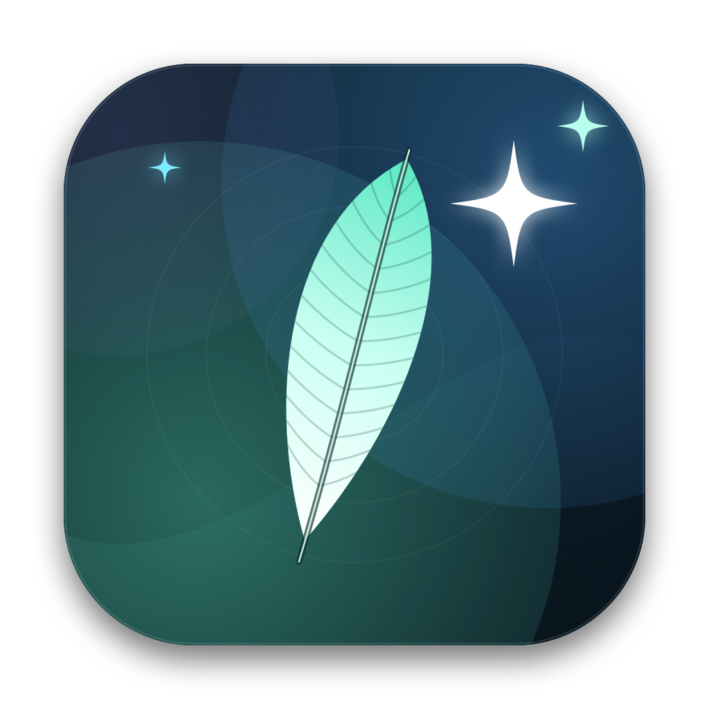
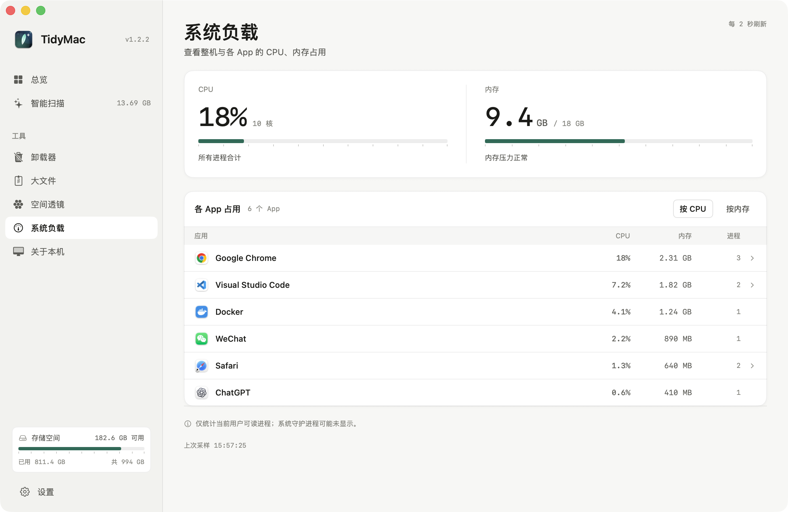
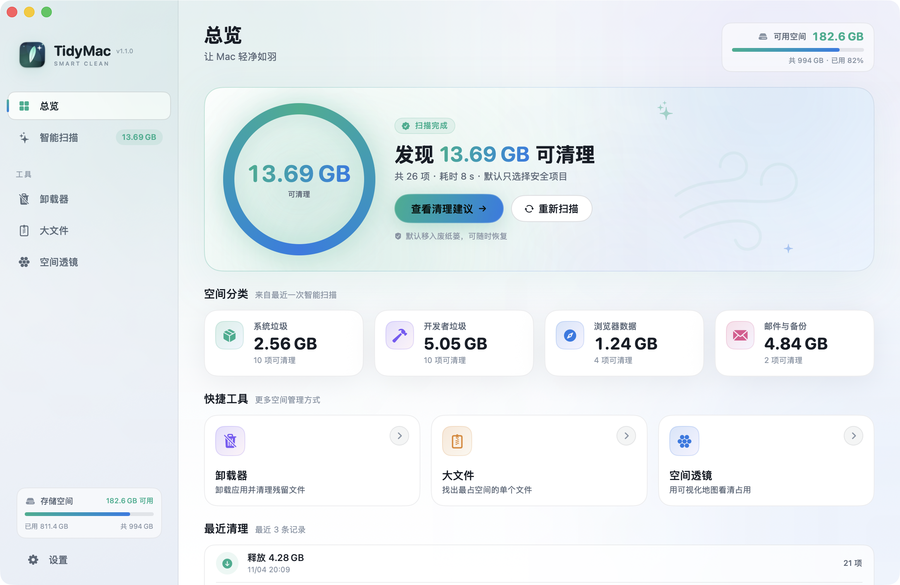
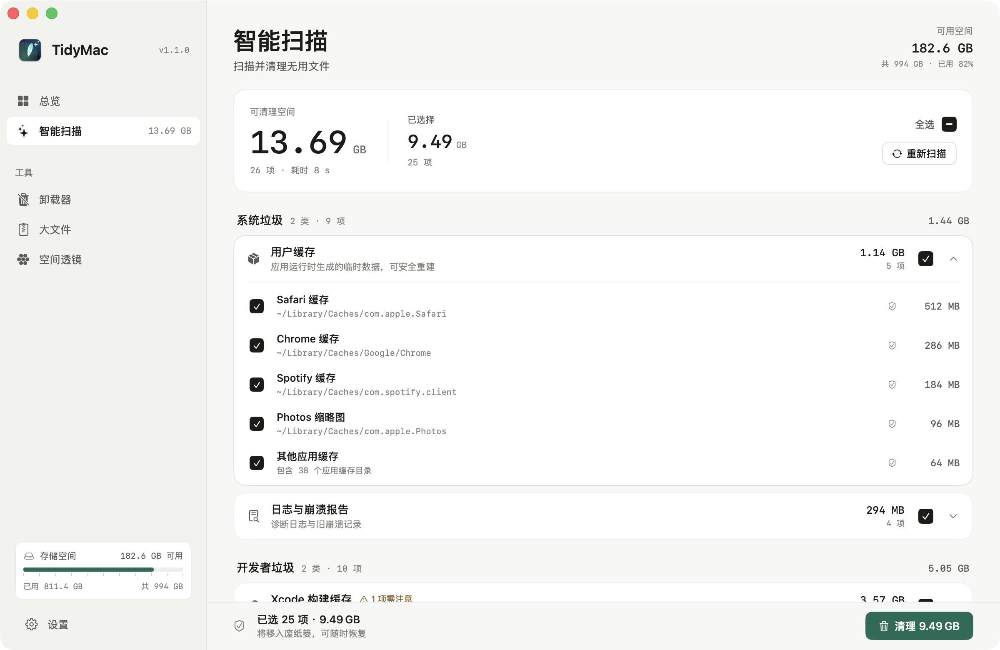
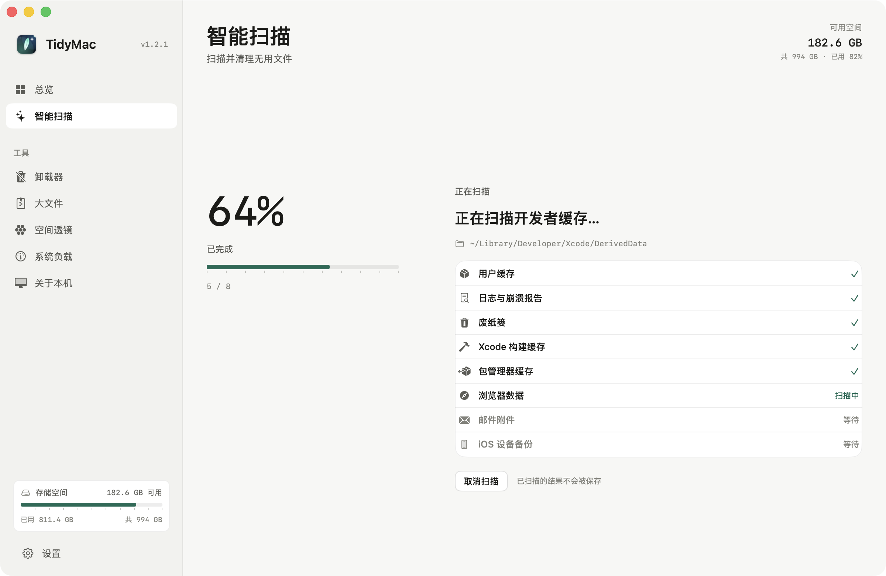
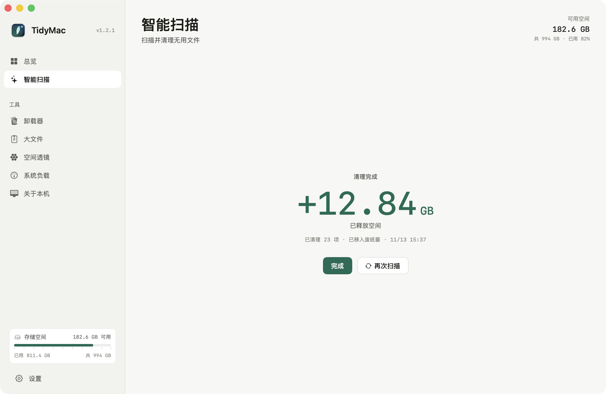
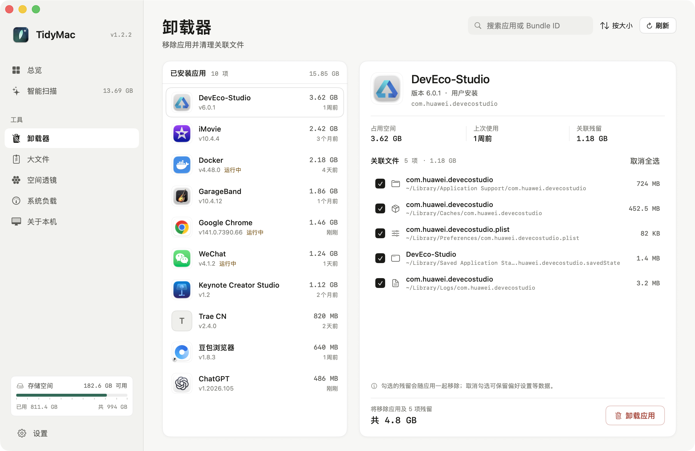
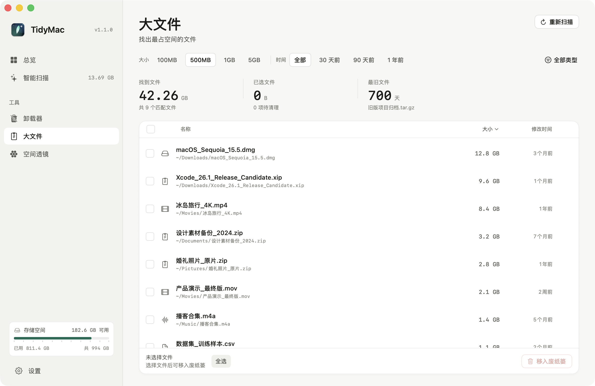
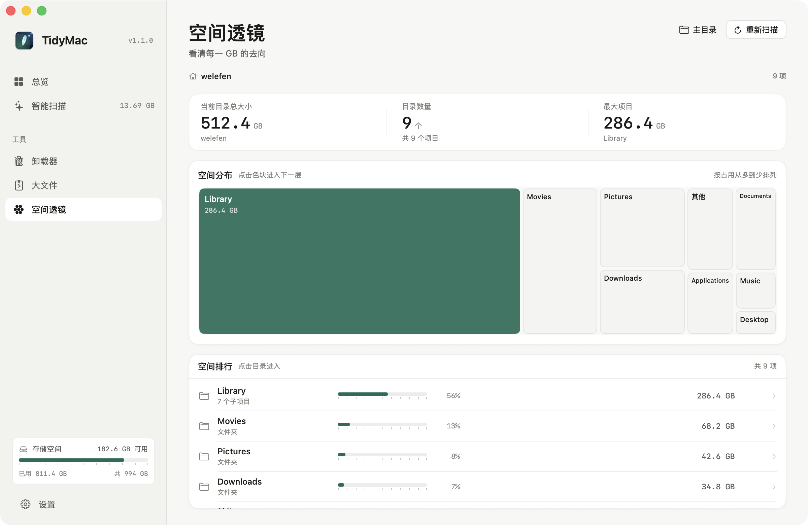
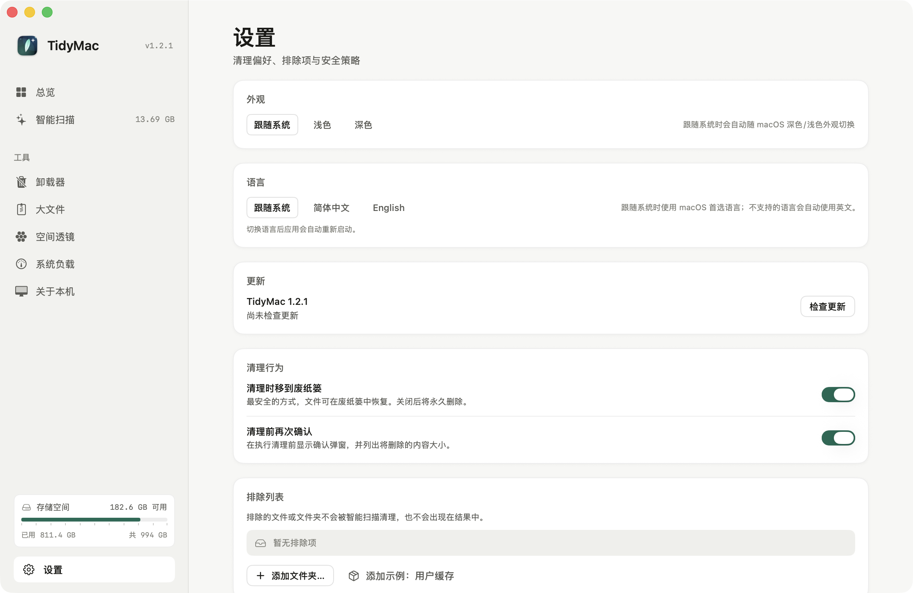

# TidyMac

[简体中文](README.zh-CN.md) | [English](README.md)

> 轻净如羽，焕然一新。一款为 macOS 打造的智能清理与空间管理工具。



TidyMac 是一个原生 SwiftUI macOS 应用：扫描系统缓存与开发者垃圾、彻底卸载应用、寻找大文件、用空间透镜看清磁盘去向，并实时监控各 App 的 CPU 与内存占用。支持浅色 / 深色外观并跟随系统，所有文件分析都在本机完成，仅上报匿名功能使用统计（详见[匿名使用统计](#匿名使用统计)）；**默认移入废纸篓**，并对系统目录、钥匙串、照片图库等路径做硬性保护。

[](https://github.com/welefen/TidyMac/raw/main/updates/TidyMac-1.1.0.zip)

也可以下载 [DMG 磁盘映像](https://github.com/welefen/TidyMac/raw/main/updates/TidyMac-1.1.0.dmg)。

## 功能

### 智能扫描
- 用户缓存、日志与崩溃报告、废纸篓
- Xcode DerivedData / DeviceSupport / 模拟器缓存
- npm、pnpm、Homebrew、pip、CocoaPods、SwiftPM、Gradle、Go、Cargo 缓存
- Safari / Chrome / Firefox / Edge 网页缓存
- 邮件附件、iOS 设备备份（默认不勾选）
- 扫描结果按类别分组、可逐项勾选、显示安全等级与路径；一键清理前二次确认
- 悬停扫描结果即可将对应目录加入排除列表，无需前往设置；结果页支持直接撤销
- 清理默认移入废纸篓，可恢复；可在设置中切换永久删除

### 卸载器
- 扫描 `/Applications` 与 `~/Applications`，显示占用空间与最近使用时间
- 查找应用关联的 Application Support、缓存、偏好设置、窗口状态、日志残留
- 支持搜索、排序、逐项选择残留；卸载前确认；失败原因清晰展示

### 大文件
- 从下载、文稿、桌面、影片、图片、音乐中找出大文件
- 按大小、时间、类型筛选，支持在 Finder 中显示与批量移入废纸篓

### 空间透镜
- Treemap 可视化主目录空间分布
- 面包屑下钻、空间排行、占比条
- 支持选择任意目录重新分析

### 系统负载
- 整机 CPU 与内存总览：使用率、核心数、内存压力与交换空间
- 按 App 汇总 CPU 与内存占用，并展开查看各子进程明细
- 每 2 秒刷新；仅统计当前用户可读取的进程
- 悬停任意 App 即可结束它；系统应用、TidyMac 自身以及无法结束的 App 不显示结束按钮
- 演示数据截图：



### 自动更新
- 应用内通过 GitHub Contents API 检查 `updates/latest.json`，raw.githubusercontent.com 作为兜底
- 发现新版本后自动下载 ZIP，校验 SHA-256 与 Bundle 信息
- 每次启动自动检查并下载；下载完成后 TidyMac 标题旁会出现浅绿色更新按钮，悬停展开「完成更新」，点击即可安装并重启
- 更新资源位于 `updates/`，发布脚本：`./scripts/publish_update.sh --push`

> 自动更新要求 GitHub 仓库为 **公开仓库**。私有仓库需要配置公开镜像或代理，不要将 GitHub Token 写入应用。

### 多语言
- 简体中文 / English
- 默认跟随系统；不支持的系统语言自动回退到英文
- 设置中切换后应用自动重新启动生效

### 匿名使用统计
- 直接使用官方 [Aptabase Swift SDK](https://github.com/aptabase/aptabase-swift)（隐私优先的开源分析服务），App Key `A-US-4062145019` 对应美国区端点 `https://us.aptabase.com`
- 默认开启上报匿名功能事件；不使用 cookie、设备 ID 或广告标识
- 每次启动由 SDK 生成随机数字 `sessionId`，闲置 1 小时后自动更换
- SDK 自动附带系统属性：应用版本/构建号、macOS 版本、语言、Mac 机型和 SDK 版本
- **绝不上报：** 文件路径、文件名、文件内容或扫描结果明细
- 中英文暂时共用 Aptabase；Provider 层已封装，后续英文可切换为其他服务
- 事件（无需提前注册）：`app_start`、`app_end`、`page_view`、`scan_start`、`scan_cancel`、`scan_complete`、`exclude_item`、`clean_start`、`clean_complete`、`uninstall_start`、`uninstall_complete`、`large_files_scan`、`large_files_clean`、`space_lens_scan`

### 设置与安全
- 浅色 / 深色 / 跟随系统三种外观，设置中即时切换，全局自适应
- 排除列表（文件 / 文件夹）
- 完全磁盘访问权限引导
- 累计释放空间、清理次数与历史
- 所有删除操作经过 `SafetyPolicy` 校验

## 截图

截图均使用 `--demo` 演示数据，不涉及真实用户文件，并统一使用浅色外观。

| 总览 | 智能扫描 · 结果 |
| --- | --- |
|  |  |

| 扫描中 | 清理完成 |
| --- | --- |
|  |  |

| 卸载器 | 大文件 |
| --- | --- |
|  |  |

| 空间透镜 | 设置 |
| --- | --- |
|  |  |

> 扫描引导页与空结果页见 [smartscan-idle.png](screenshots/zh/smartscan-idle.png)、[smartscan-empty.png](screenshots/zh/smartscan-empty.png)。

## 快速开始

环境要求：macOS 14+、Apple Silicon（当前构建为 arm64）、Command Line Tools（无需完整 Xcode）。

```bash
# 1. 生成应用图标（可选，仓库已包含 icns）
./scripts/make_icon.sh

# 2. 构建 .app 与命令行工具
./build.sh

# 3. 运行
open build/TidyMac.app

# 4. 可选：安装到「应用程序」文件夹（方便授予完全磁盘访问权限）
./scripts/install.sh
```

### 完全磁盘访问权限

macOS **不会自动**把第三方 App 加入「完全磁盘访问权限」列表，需要手动添加：

1. 打开「系统设置 → 隐私与安全性 → 完全磁盘访问权限」
2. 点击列表下方的 **+**
3. 选择 `/Applications/TidyMac.app`（应用内权限提示条提供「在 Finder 中显示」按钮，可直接拖入列表）
4. 打开 TidyMac 右侧的开关，然后**重启 TidyMac**

未授权时，`~/Library/Mail`、`~/.Trash` 等受 TCC 保护的位置会被跳过，扫描结果可能不完整。

演示模式（使用内置示例数据，不扫描真实磁盘）：

```bash
build/TidyMac.app/Contents/MacOS/TidyMac --demo --page overview
build/TidyMac.app/Contents/MacOS/TidyMac --demo --page smartscan --demo-state scanning
build/TidyMac.app/Contents/MacOS/TidyMac --demo --page smartscan --demo-state results
build/TidyMac.app/Contents/MacOS/TidyMac --demo --page smartscan --demo-state finished
build/TidyMac.app/Contents/MacOS/TidyMac --demo --page smartscan --demo-state idle
build/TidyMac.app/Contents/MacOS/TidyMac --demo --page uninstaller
build/TidyMac.app/Contents/MacOS/TidyMac --demo --page large
build/TidyMac.app/Contents/MacOS/TidyMac --demo --page space
```

重新生成文档截图（需已构建）：

```bash
./scripts/shoot.sh overview "" overview
./scripts/shoot.sh smartscan results smartscan-results
./scripts/shoot.sh uninstaller "" uninstaller
```

命令行诊断工具：

```bash
build/tidymac-cli scan          # 只读扫描系统垃圾
build/tidymac-cli apps          # 列出应用及占用
build/tidymac-cli large --min 100
build/tidymac-cli lens ~ 2
build/tidymac-cli selftest      # 安全策略 / 大小计算 / 清理逻辑自检
```

打包可分发的 ZIP（在支持 `hdiutil` 的环境中同时生成 DMG）：

```bash
./scripts/package.sh
```

构建产物：

- `build/TidyMac.app` — 可直接运行的应用
- `build/tidymac-cli` — 无界面诊断/自检工具
- `dist/TidyMac-1.1.0.dmg` — 磁盘映像（拖入「应用程序」安装）
- `dist/TidyMac-1.1.0.zip` — 分发压缩包（ad-hoc 签名，解压后拖入「应用程序」）
- `dist/SHA256SUMS.txt` — 校验和

## 验证结果

- `./build.sh`：Swift 5 模式、42 个源文件，无 warning 构建通过（arm64 / macOS 14+）
- `build/tidymac-cli selftest`：**15/15 通过**（安全策略、大小计算、临时目录清理、受保护路径、排除项、废纸篓特殊分支）
- 真实只读扫描：**3.7 秒**，发现 **17.42 GB / 29 项**（用户缓存 12.91 GB、日志 111.7 MB、包管理器缓存 2.15 GB、Chrome 缓存 2.24 GB）
- 引擎 CLI 实测：`apps` 12 个应用 / 2.8s；`large --min 200` 11 个文件 / 13.06 GB；`lens ~ 2` 73.24 GB / 约 14s
- UI 全流程实测（demo）：清理确认弹窗 → cleaning → finished → 完成回总览；四个扫描状态、空结果、最小窗口尺寸均验证无截断
- 真实模式实测：启动、自动扫描、结果渲染、卸载器/大文件/空间透镜页加载均正常

## 安全设计

TidyMac 遵循「宁可漏扫，也不误删」：

- 每次删除前调用 `SafetyPolicy.validate(_:context:)`；受保护路径（`/System`、`/Library`、`~/.ssh`、钥匙串、照片图库、Mail 数据库、iCloud 文档等）永远拒绝
- 默认使用 `FileManager.trashItem` 移入废纸篓；废纸篓清空单独处理
- 解析并标准化路径，防止 `..` 越权；不跟随符号链接删除目标
- 清理范围白名单：用户缓存 / 日志 / 开发者缓存 / Downloads / Trash 等
- 扫描与清理全程本地进行，无网络请求、无遥测
- 系统应用默认从卸载器隐藏

## 架构

```
Sources/
  App/        App 入口、窗口、全局状态、设置、演示数据
  Core/       纯 Foundation 引擎：扫描、清理、安全策略、卸载器、大文件、空间透镜
  UI/         SwiftUI 页面与设计系统（Theme / Components / 六个页面）
  CLI/        无界面诊断与自检工具
scripts/      图标生成、截图、打包
Resources/    Info.plist、AppIcon.icns
```

- 无第三方依赖
- 构建脚本使用 macOS 15.4 SDK，部署目标 macOS 14
- `--demo` 模式与真实引擎解耦，便于 UI 设计、截图与验收
- 界面支持简体中文与英文；中文文案作为本地化 key，英文资源位于 `Resources/en.lproj/Localizable.strings`
- 默认跟随系统语言；未支持的系统语言回退到英文（`CFBundleDevelopmentRegion = en`）

## 已知限制

- 未开启「完全磁盘访问权限」时，Safari、Mail 等目录读取会受限，扫描结果可能不完整（应用内会提示）
- App Store / root 拥有的应用会请求管理员授权，授权后移入废纸篓并修正所有者
- 首次真实扫描 Xcode DerivedData 等大目录可能需要数秒至数十秒
- 当前为本地 ad-hoc 签名构建，未做公证；分发给其他 Mac 时需在「系统设置 → 隐私与安全性」中允许
- 空间透镜为按需深度扫描，超大目录建议选择子目录分析
- 卸载器不列出 `/Applications/Utilities` 等嵌套应用；`~/Library/Containers` 残留受安全策略保护，不会出现在可清理列表
- `/System/Applications` 与 Apple 自带应用受 macOS 系统完整性保护（SIP），仅可在卸载器中查看，无法卸载；可在设置中关闭「显示系统应用」
- 未开启完全磁盘访问权限时，`~/Library/Mail`、`~/.Trash` 等受 TCC 保护的位置会被静默跳过

## License

MIT License

仅用于学习与个人使用
